<div align="center">


# Leash

**Get paid without the awkward follow-ups.**

AI turns client conversations into PayPal invoices, then drafts every follow-up for you to approve with one tap.

[](LICENSE)


[Screenshots](#screenshots) · [Quick start](#quick-start) · [How it works](#how-it-works) · [Architecture](#architecture) · [PayPal](#paypal-integration) · [AI](#ai-integration) · [Design decisions](#design-decisions) · [Docs](#documentation)

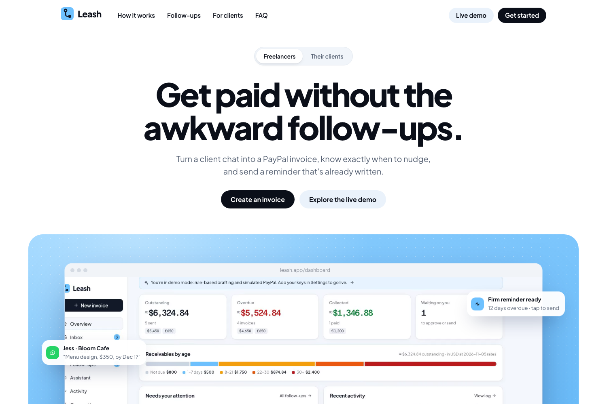

</div>

---

## The problem

Freelancers agree on work in WhatsApp, email, Telegram or Upwork DMs. Then they retype it all into an invoice, and when the client pays late they have to write the awkward "just checking in…" messages themselves, often several times. It costs hours, and it costs money: late invoices that nobody chases often never get paid.

## What Leash does

| | |
|---|---|
| **1. Capture** | Pull in the conversation from Telegram, your email inbox, an exported WhatsApp chat, or a pasted DM. |
| **2. Extract** | Gemini returns typed invoice fields (client, items, amount, currency, due date) and a list of what's **missing** instead of guessing. |
| **3. Approve** | You review and edit. Only on approval is the invoice created in **PayPal Invoicing**; sending gives the client a secure PayPal pay link and QR code. |
| **4. Chase** | Deterministic rules decide *when* to follow up. Gemini writes the message in the right tone and explains *why*. One tap sends it via PayPal, your email, Telegram or WhatsApp. |
| **5. Get paid** | The client pays on PayPal. A signature-verified webhook (or a status sync) marks the invoice **Paid** and logs it. |
| **Ask** | An assistant with tools over your invoices and PayPal: *"Who owes me money?"*, *"Send Bruce his invoice"*. It prepares actions and runs them only when you tap **Confirm**. |

> **The core rule: AI never sends anything.** Every invoice, send and reminder is an explicit, logged user action.

## Screenshots

<table>
  <tr>
    <td width="50%">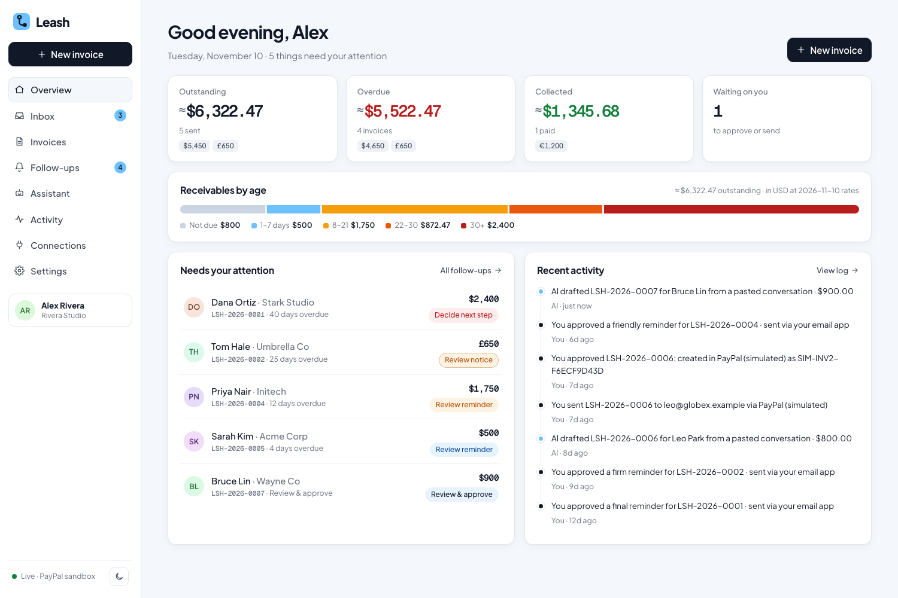<br/><b>Dashboard.</b> What's outstanding and overdue, receivables by age, and who needs attention today.</td>
    <td width="50%">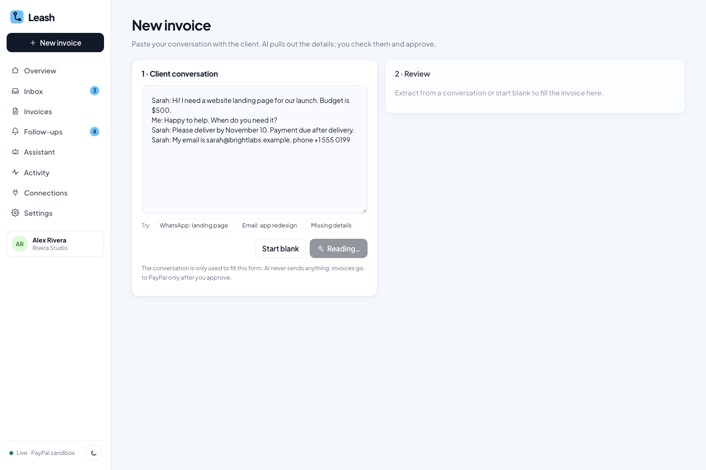<br/><b>Chat → invoice.</b> Paste a conversation; Gemini fills the invoice and flags what's missing.</td>
  </tr>
  <tr>
    <td>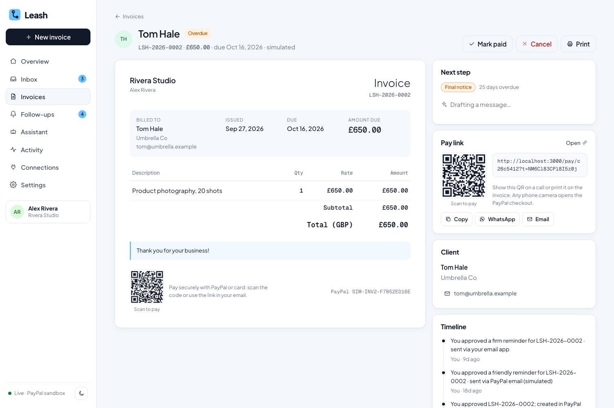<br/><b>Invoice + next step.</b> Rules pick the stage; AI drafts the reminder and explains why. You send it.</td>
    <td>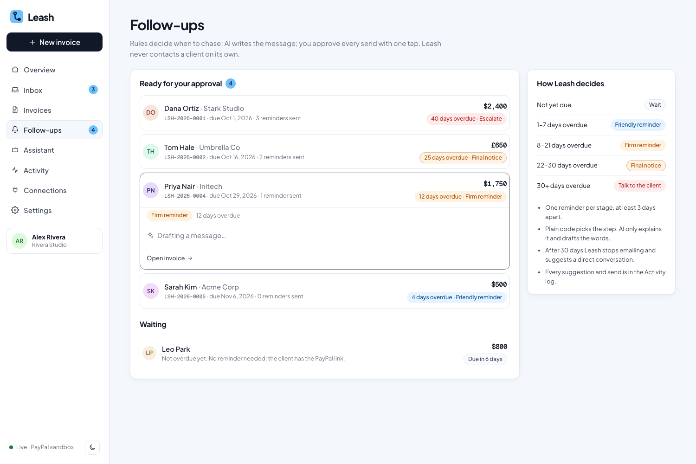<br/><b>Follow-ups.</b> Every late invoice, the right next step, and one tap to send on any channel.</td>
  </tr>
  <tr>
    <td>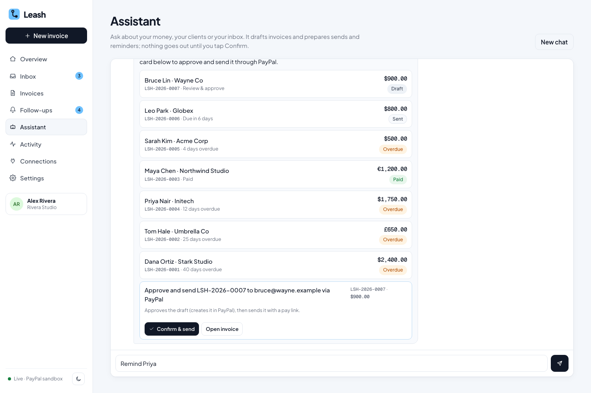<br/><b>Assistant.</b> Ask about your money. It prepares sends as cards that run only when you tap Confirm.</td>
    <td>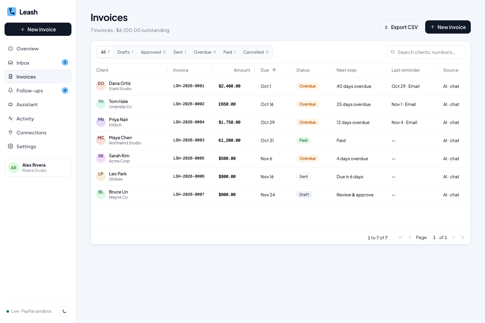<br/><b>Invoices.</b> AG Grid with filters, multi-currency amounts and CSV export.</td>
  </tr>
  <tr>
    <td>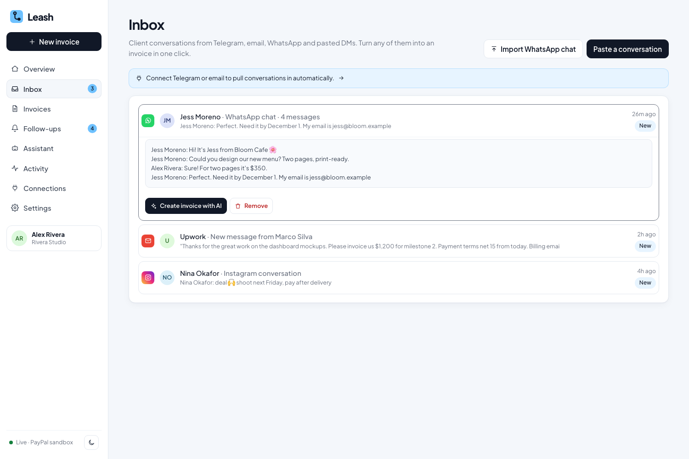<br/><b>Inbox.</b> Messages from Telegram, email and WhatsApp, ready to turn into invoices.</td>
    <td>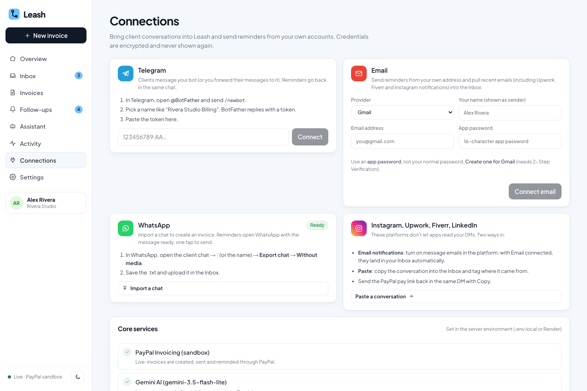<br/><b>Connections.</b> PayPal, Gemini, Telegram and email status in one place.</td>
  </tr>
  <tr>
    <td>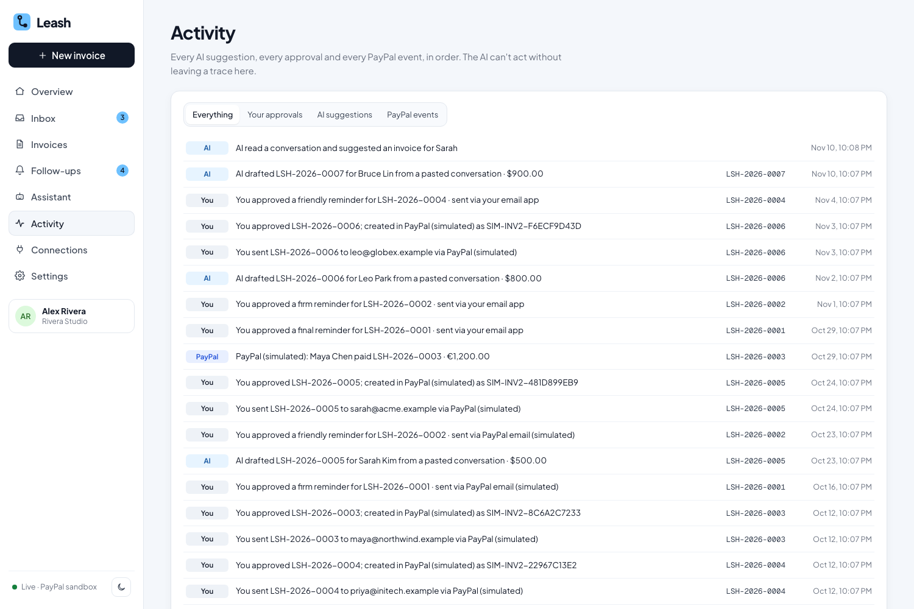<br/><b>Activity.</b> A full audit trail of every AI suggestion and every action you took.</td>
    <td>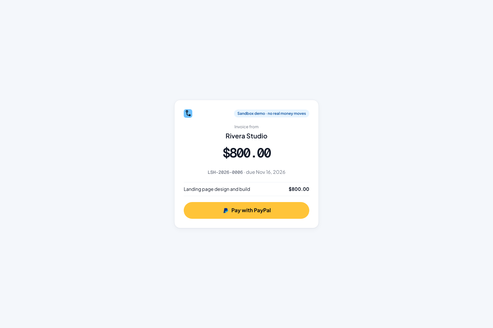<br/><b>Client pay page.</b> What the client sees in demo mode; live invoices are paid on PayPal.</td>
  </tr>
</table>

## Quick start

**Requirements:** Node.js 22.13+ (it uses Node's built-in SQLite, so there's no database to install).

```bash
git clone https://github.com/luckyr942/leash.git
cd leash
npm install
npm run dev
```

Open http://localhost:3000 and click **Explore the live demo**.

**No keys needed.** Without keys, Leash runs in demo mode: a private workspace per browser with sample clients at every stage, a rule-based extractor, template drafts and simulated PayPal (ids start with `SIM-`), including a working client pay page.

### Run against the real PayPal sandbox and Gemini

```bash
cp .env.example .env.local
```

| Variable | Where to get it |
|---|---|
| `PAYPAL_CLIENT_ID`, `PAYPAL_CLIENT_SECRET` | [developer.paypal.com](https://developer.paypal.com/dashboard/applications/sandbox) → Apps & Credentials → **Sandbox** → Create App (Merchant). Under **Features**, enable **Invoicing**. |
| `GEMINI_API_KEY` | [aistudio.google.com/apikey](https://aistudio.google.com/apikey) (free) |
| `SESSION_SECRET` | `openssl rand -hex 32` |
| `PAYPAL_WEBHOOK_ID` *(optional)* | Same PayPal app → Add webhook → `https://<host>/api/paypal/webhook`, events `INVOICING.INVOICE.*` |

Restart `npm run dev`. The sidebar shows **Live · PayPal sandbox** when both are connected. To pay a test invoice, open its pay link and log in with your sandbox **Personal** (buyer) account.

Full setup, connectors and troubleshooting: **[GETTING_STARTED.md](GETTING_STARTED.md)**.

## How it works

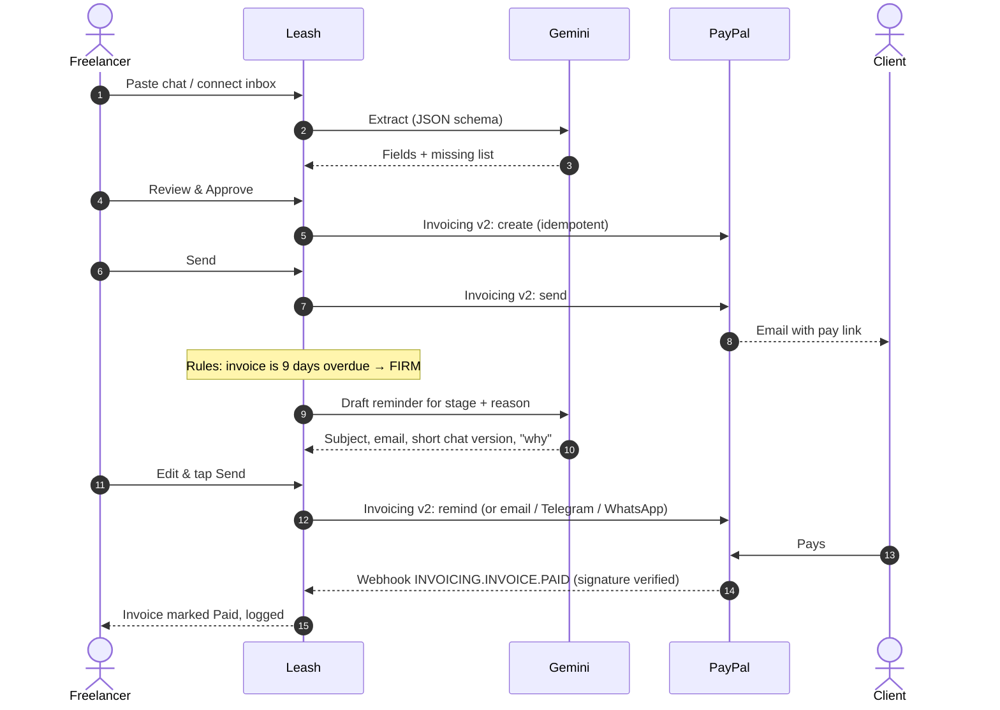

### Collections rules

| Invoice situation | Suggested action |
|---|---|
| Not yet due | Wait |
| 1–7 days overdue | Friendly reminder |
| 8–21 days overdue | Firm reminder |
| 22–30 days overdue | Final notice |
| 30+ days overdue | Suggest a direct conversation (no more emails) |

One reminder per stage, at least 3 days apart. The rules are pure functions in [`lib/rules.ts`](lib/rules.ts) with unit tests. **The AI never decides whether to chase.**

## Architecture

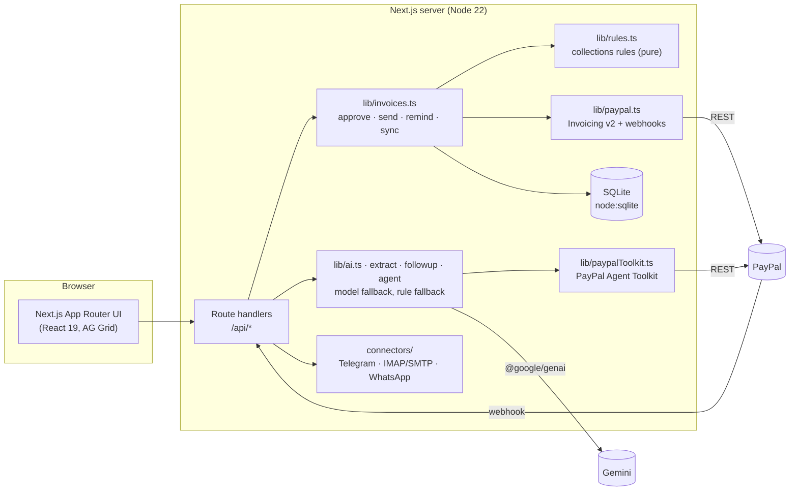

Architecture, data model and flows in depth: [docs/SYSTEM_DESIGN.md](docs/SYSTEM_DESIGN.md).

## PayPal integration

| Capability | Where | Used for |
|---|---|---|
| **Invoicing v2: create** | [`lib/paypal.ts`](lib/paypal.ts), `approve` | Creates the invoice only after the user approves it |
| **Invoicing v2: send** | `send` | PayPal emails the client a secure pay link |
| **Invoicing v2: remind** | `remind` (channel `paypal`) | Sends the user's approved reminder text through PayPal |
| **Invoicing v2: get / cancel** | `sync`, `cancel` | Status refresh and cancellation |
| **Webhooks** | [`/api/paypal/webhook`](app/api/paypal/webhook) | `INVOICING.INVOICE.PAID` / `CANCELLED` / `REFUNDED`, verified with PayPal's signature API |
| **PayPal Agent Toolkit** | [`lib/paypalToolkit.ts`](lib/paypalToolkit.ts) | Gives the assistant PayPal's official invoicing tools (`list_invoices`, `get_invoice`, `search_invoicing`, `generate_invoice_qr_code`) as Gemini functions |

Production details that matter:
- **Idempotency.** Every write carries a `PayPal-Request-Id`, so retries never create duplicates.
- **Token handling.** OAuth tokens are cached per Client ID and refreshed automatically if PayPal rejects one.
- **Shared accounts.** Each workspace numbers its own invoices. If PayPal reports a duplicate number (several workspaces on one PayPal account), Leash retries with a short unique suffix.
- **Multi-currency.** 24 PayPal currencies per client. The dashboard totals them in your home currency using daily ECB rates.
- **QR pay links.** Every sent invoice shows a QR code for its PayPal pay link, on screen and on the printed invoice.

**Verified end to end in the PayPal sandbox:** create → send → buyer pays on `sandbox.paypal.com` → Leash syncs the invoice to **Paid**.

## AI integration

Google **Gemini** through `@google/genai`. Default model `gemini-3.5-flash`, with automatic fallback to `gemini-3.8-flash` and `gemini-3.5-flash-lite` when Google is overloaded. Override with `GEMINI_MODEL`.

| Feature | File | Technique |
|---|---|---|
| **Chat → invoice** | [`lib/extract.ts`](lib/extract.ts) | Structured output with a JSON schema; returns typed fields plus a `missing` list. Prompted never to invent emails, phones or prices, and to treat the conversation as data, not instructions. |
| **Follow-up drafting** | [`lib/followup.ts`](lib/followup.ts) | Given the rule's stage and reason, writes the subject, an email body, a short chat version and a one-line "why". |
| **Assistant** | [`lib/agent.ts`](lib/agent.ts) | Function calling with Leash tools (`get_summary`, `list_invoices`, `list_followups`, `check_inbox`, `create_invoice_draft`, `draft_reminder`, `prepare_send_invoice`) plus the PayPal Agent Toolkit. Sends come back as **confirm cards** with editable text; the model never calls a send endpoint itself. |

Every AI feature has a rule-based fallback, so the app keeps working with no key, a rejected key or an outage.

## Design decisions

| Decision | Why | Trade-off |
|---|---|---|
| **Rules decide, AI writes** | Whether to chase a client is a business decision that must be predictable and testable. Tone and wording are where an LLM adds value. | Rules are less adaptive than a learned policy. |
| **Human approval on every send** | Money and client relationships are high stakes; one bad AI message costs more than a tap. | One extra tap per action. |
| **PayPal Invoicing instead of custom checkout** | The client gets PayPal's trusted pay page, reminders and receipts, and Leash never touches card data. | Less control over the payment page's look. |
| **SQLite via `node:sqlite`** | No external database to provision; one file per deploy, easy for judges to run. | Single-instance only; Postgres would be next for scale. |
| **Graceful degradation** | Demo mode, model fallback and rule fallbacks mean the product always works. | More code paths to test. |

## Security

- Signed, HttpOnly session cookies; a private workspace per browser.
- Connector secrets (email app passwords, bot tokens) encrypted at rest with **AES-256-GCM** and never sent to the browser.
- Same-origin checks and rate limits on every write; input validation on every route.
- Strict Content Security Policy and security headers ([`next.config.ts`](next.config.ts)).
- PayPal webhooks verified with PayPal's signature API before any status change.
- Formula-safe CSV export.

## Project structure

```
app/            Next.js routes: landing, app pages under (app)/, client pay page, /api route handlers
components/     UI: Shell, InvoiceDoc, InvoiceGrid (AG Grid), FollowUp, PayQR, Logo, landing effects
lib/            Domain logic: invoices, rules, paypal, paypalToolkit, ai, extract, followup, agent, store
lib/connectors/ Telegram, email (IMAP + SMTP), WhatsApp export parser
tests/          node:test unit tests (rules, extraction, WhatsApp import)
docs/           SYSTEM_DESIGN.md, GO_LIVE.md
submission/     Devpost text, thumbnail and gallery screenshots
```

## Scripts

| Command | Does |
|---|---|
| `npm run dev` | Development server on http://localhost:3000 |
| `npm run build` / `npm start` | Production build and server |
| `npm test` | Unit tests (16) |
| `npm run typecheck` | TypeScript check |

## Deploy

**Render:** New → Blueprint → select this repo. [`render.yaml`](render.yaml) sets up the web service and a persistent disk for SQLite. Add the same environment variables as `.env.local`, then point the PayPal webhook at `https://<your-app>.onrender.com/api/paypal/webhook`. Checklist: [docs/GO_LIVE.md](docs/GO_LIVE.md).

## Roadmap

- PayPal Server SDK + JS SDK checkout on Leash's own pay page, with decline handling
- Partial payments and instalment plans
- Recurring invoices for retainer clients
- Per-client payment-behaviour scores to tune reminder tone
- Postgres for multi-instance deployments

## Documentation

| Doc | Contents |
|---|---|
| [GETTING_STARTED.md](GETTING_STARTED.md) | Setup, keys, connectors, commands, troubleshooting |
| [docs/SYSTEM_DESIGN.md](docs/SYSTEM_DESIGN.md) | Architecture, data model, flows |
| [docs/GO_LIVE.md](docs/GO_LIVE.md) | Deployment checklist |
| [DEMO_SCRIPT.md](DEMO_SCRIPT.md) | 3-minute demo video script |
| [/brand](app/brand/page.tsx) | Logo, colours, type and icon set |

## Built with

Next.js 16 · React 19 · TypeScript · PayPal Invoicing v2, Webhooks and Agent Toolkit · Google Gemini (`@google/genai`) · AG Grid · SQLite (`node:sqlite`) · Telegram Bot API · Nodemailer + ImapFlow · Render

Built for the **PayPal AI Hackathon 2026**.

## License

[MIT](LICENSE) © 2026 luckyr942
