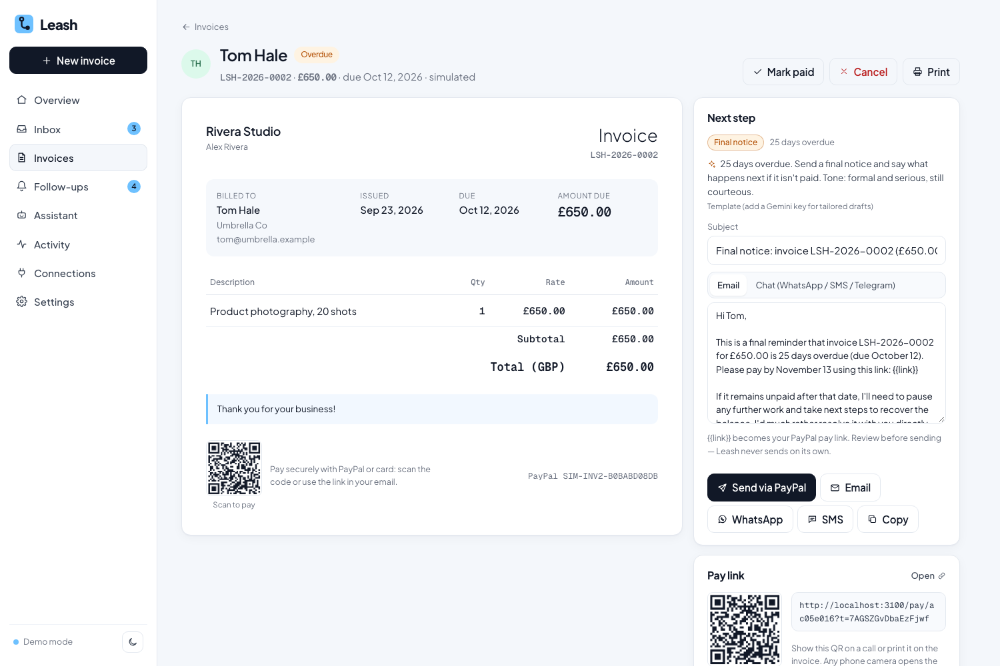

# Leash

**Get paid without the awkward follow-ups.**

Freelancers lose hours (and money) turning chats into invoices and then chasing clients who pay late. Leash fixes both:

1. **Bring in the client conversation.** Telegram bot, your email inbox, an exported WhatsApp chat, or a pasted Instagram / Upwork / Fiverr DM. AI extracts the client, the work, the amount and the due date, and flags anything missing instead of guessing.
2. **Review and approve.** Edit anything. Only on approval does Leash create the invoice in **PayPal Invoicing**; sending it gives the client a secure PayPal pay link.
3. **Leash chases, you tap.** Deterministic rules decide *when* to follow up; AI explains *why* and drafts the message in the right tone. One tap sends it via **PayPal**, **your own email**, **Telegram**, **WhatsApp** or **SMS**. Nothing is sent without that tap.
4. **Ask the assistant.** "Who owes me?", "Check my messages", "Invoice this chat", "Send Bruce his invoice": a Gemini agent with tools over your data that prepares sends and runs them only when you tap Confirm.
5. **Everything is logged.** Created, approved, sent, reminded, paid: a full activity trail, per invoice and overall.



> **New here?** [GETTING_STARTED.md](GETTING_STARTED.md) has setup, keys, commands, a project map, deploy steps and troubleshooting.

## Try it in 10 seconds

```bash
npm install && npm run dev   # http://localhost:3000
```

No keys needed. **Demo mode** gives every visitor a private workspace with sample clients at every stage (not due, 4 / 12 / 25 / 40 days overdue, paid, draft), a rule-based extractor, template drafts and simulated PayPal (ids start with `SIM-`). The pay link even opens a simulated client pay page, so the full loop works end to end. Add keys and the same screens use Gemini and the real PayPal sandbox.

## Collections rules

| Invoice situation | Suggested action |
|---|---|
| Not yet due | Wait |
| 1–7 days overdue | Friendly reminder |
| 8–21 days overdue | Firm reminder |
| 22–30 days overdue | Final notice |
| 30+ days overdue | Suggest a direct conversation (no more emails) |

One reminder per stage, at least 3 days apart. The rules live in [`lib/rules.ts`](lib/rules.ts) (pure, unit-tested); the AI never decides whether to chase.

## How PayPal is used

| PayPal API | Where | What for |
|---|---|---|
| **Invoicing v2: create** | `lib/paypal.ts` → `approve` | Creates the invoice only after you approve it |
| **Invoicing v2: send** | `send` | PayPal emails the client a secure pay link (`recipient_view_url`) |
| **Invoicing v2: remind** | `remind` with channel `paypal` | Sends *your approved* reminder text through PayPal |
| **Invoicing v2: get / cancel** | `sync`, `cancel` | Status refresh and cancellation |
| **Webhooks** (signature-verified) | `/api/paypal/webhook` | `INVOICING.INVOICE.PAID` / `CANCELLED` update status automatically |
| Idempotency (`PayPal-Request-Id`) | every create | No duplicate invoices on retries |
| **PayPal Agent Toolkit** (`@paypal/agent-toolkit`) | `lib/paypalToolkit.ts` | Live mode: the assistant gets PayPal's official read-only invoicing tools (`list_invoices`, `get_invoice`, `search_invoicing`, `generate_invoice_qr_code`) as Gemini functions |

**Multi-currency.** Bill each client in their own currency (24 PayPal currencies). The dashboard shows exact per-currency amounts plus an approximate total in your home currency, using daily European Central Bank rates (Frankfurter, keyless).

**Pay-link QR codes.** Every sent invoice shows a QR code for its pay link, on screen and on the printable invoice, drawn locally in the browser.

## Connectors

| Source | How | Sending back |
|---|---|---|
| **Telegram** | Your own bot (free, from @BotFather). Clients message it, or you forward their messages; Leash polls it (no public URL needed) | Reminders posted in that chat |
| **Email** (Gmail, Outlook, Zoho, Yahoo, any IMAP/SMTP) | App password; Leash reads recent mail, including Upwork/Fiverr/Instagram notification emails | Reminders sent from your own address |
| **WhatsApp** | Upload an exported chat (.txt) | One tap opens WhatsApp with the message (wa.me) |
| **Instagram, Upwork, Fiverr, LinkedIn** | No public DM APIs: via their notification emails, or paste | Copy the message / pay link |

Credentials are encrypted at rest (AES-256-GCM) and never returned to the browser.

## How AI is used

Google **Gemini** (free tier; default `gemini-3.5-flash` with automatic fallback to `gemini-3.8-flash` and `gemini-3.5-flash-lite` when Google is busy; set `GEMINI_MODEL` to change). If no key is set, or Google rejects it, Leash falls back to built-in rule-based logic automatically.

- **Chat → invoice** ([`lib/extract.ts`](lib/extract.ts)): Gemini with a JSON schema returns typed fields plus a `missing` list. Prompted to never invent emails, phones or prices; the conversation is treated as data, not instructions.
- **Follow-up drafting** ([`lib/followup.ts`](lib/followup.ts)): given the rule's stage and reason, Gemini writes the subject, an email body, a short WhatsApp/SMS version and a one-line "why". If the model is unavailable, a template is used so follow-ups never block.
- **Assistant** ([`lib/agent.ts`](lib/agent.ts)): Gemini function calling with tools `get_summary`, `list_invoices`, `list_followups`, `check_inbox`, `create_invoice_draft`, `draft_reminder`, `prepare_send_invoice` (plus PayPal Agent Toolkit tools in live mode). It **transacts with your confirmation**: "Send the invoice to Bruce" or "Remind Priya by email" returns a card with the exact action and editable text, and it only runs when you tap **Confirm & send**. The model itself never calls a send endpoint.
- All three have rule-based fallbacks so the app runs without keys.

## Safety by design

- AI **cannot** send anything: approval, sending and every reminder are explicit user actions.
- Every AI suggestion and every user action is written to the activity log.
- Signed, HttpOnly session per browser; same-origin checks and rate limits on every write; input validation; strict CSP and security headers; formula-safe CSV export.
- Leash never sees card or bank details; PayPal handles payment.

See [docs/SYSTEM_DESIGN.md](docs/SYSTEM_DESIGN.md) for architecture, data model and flows.

## Run with real PayPal sandbox + Gemini

```bash
cp .env.example .env.local   # fill in the keys below
npm run dev
```

| Variable | Where to get it |
|---|---|
| `GEMINI_API_KEY` | aistudio.google.com/apikey (free) |
| `PAYPAL_CLIENT_ID`, `PAYPAL_CLIENT_SECRET` | developer.paypal.com → Apps & Credentials → **Sandbox** → Create App |
| `PAYPAL_WEBHOOK_ID` (optional) | same app → Add Webhook → `https://<host>/api/paypal/webhook`, events `INVOICING.INVOICE.*` |
| `SESSION_SECRET` | `openssl rand -hex 32` |

Use one of your sandbox **Personal** accounts' email as the client email to receive and pay the invoice in the sandbox.

## Deploy

Render: **New → Blueprint** → this repo (`render.yaml` included, with a persistent disk for the SQLite database). Full checklist: [docs/GO_LIVE.md](docs/GO_LIVE.md).

## Tech

Next.js 16 (App Router) · TypeScript · Google Gemini (`@google/genai`, JSON schema + function calling) · PayPal Invoicing v2 + Webhooks · Telegram Bot API · Nodemailer + ImapFlow · SQLite (`node:sqlite`) · AG Grid · Render.

```bash
npm test          # rules + extraction unit tests
npm run build
```

## Brand

The Leash mark is a leash shaped like an **L**: a handle loop at the top and a coin clipped to the end. It's the product in one shape: keep every payment on a lead until it comes home. See the live brand kit at [`/brand`](http://localhost:3000/brand).

- **Logo files:** [`public/brand/`](public/brand) (SVG mark in sky blue, ink and mono; lockups; 1024px PNGs). React components: [`components/Logo.tsx`](components/Logo.tsx).
- **App icons:** `app/icon.svg` and `app/favicon.ico` (favicon), `app/apple-icon.png`, `public/icon-192.png` / `icon-512.png` / `icon-maskable-512.png` (installable app, via `app/manifest.ts`), `app/opengraph-image.png` (link previews).
- **Feature icons:** 12 two-tone icons in [`components/BrandIcons.tsx`](components/BrandIcons.tsx): Capture, Extract, Approve, Chase, Ask, Paid, Multi-currency, QR pay, Confirm, Connect, Secure, Log.
- **Type:** Plus Jakarta Sans for everything (hero 800, headings 700, UI 500–600, body 400–500); Geist Mono only for invoice numbers, references and amounts.
- **Colors:** Leash sky `#6EC1FF`, Deep blue `#1A6FD1` (text accents), Ink `#111827`, Night `#0A0C11`, Paper `#F4F7FB`.

## Pages

`/` landing · `/dashboard` overview · `/inbox` conversations · `/assistant` AI agent · `/connections` · `/new` chat-to-invoice · `/invoices` (AG Grid) · `/invoices/[id]` invoice + next step · `/followups` collections queue · `/activity` audit log · `/settings` · `/pay/[id]` simulated client pay page (demo mode)

## License

MIT
