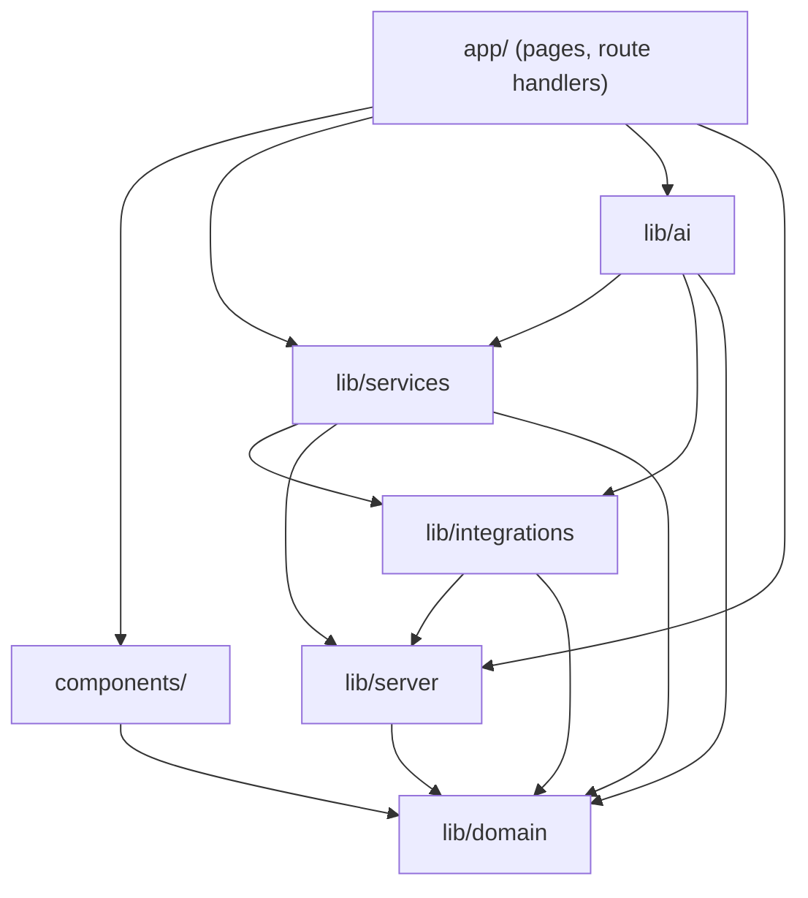

# Code architecture

How the codebase is organised, which layer may depend on which, and where to put new code.
For product flows, the data model and the collections rules, see [SYSTEM_DESIGN.md](SYSTEM_DESIGN.md).

## Folder map

```
app/                              Next.js App Router: routing only, thin handlers
├─ page.tsx                       Landing page (composes components/landing/sections)
├─ (app)/                         The signed-in app, wrapped in the sidebar shell
│  ├─ layout.tsx                  AppProvider + Shell
│  ├─ loading.tsx, error.tsx      Skeleton and error boundary inside the shell
│  └─ dashboard/ new/ invoices/ followups/ inbox/ assistant/ activity/ connections/ settings/
├─ api/                           Route handlers (JSON). Each one: withSession → validate → call a service
├─ pay/[id]/                      Client pay page (demo mode)
├─ not-found.tsx, error.tsx, global-error.tsx
└─ layout.tsx, globals.css, landing.css

components/
├─ ui/                            Generic building blocks: Primitives (pills, avatar, page head, empty state),
│                                 Icons, ThemeToggle, PageSkeleton, StatusCard
├─ layout/                        App chrome: Shell (sidebar), AppProvider (client state + API helper)
├─ invoice/                       Invoice features: InvoiceDoc, InvoiceGrid (AG Grid), FollowUp, PayQR
├─ brand/                         Logo, BrandIcons, Art (illustrations)
└─ landing/                       HeroVideo, LandingFX, PhoneQR
   └─ sections/                   One file per landing-page chapter (Hero, Features, Ladder, Faq, …)

lib/
├─ domain/                        Pure business logic. No I/O, safe in the browser
│  ├─ models.ts                   Entity types: Invoice, Client, Activity, InboxItem, Profile …
│  ├─ rules.ts                    Collections rules: wait / friendly / firm / final / call
│  ├─ format.ts                   Money, dates, status labels
│  └─ state.ts                    Shape of GET /api/state
├─ services/
│  └─ invoices.ts                 Invoice lifecycle: validate, draft, approve, send, remind, paid, cancel, sync
├─ ai/
│  ├─ client.ts                   Gemini client with model fallback and friendly errors
│  ├─ extract.ts                  Chat → invoice (JSON schema), with extract-fallback.ts (rule-based)
│  ├─ followup.ts                 Reminder drafting for the stage the rules picked
│  └─ agent.ts                    Assistant: function calling, read tools, confirm cards
├─ integrations/
│  ├─ paypal/client.ts            PayPal REST: OAuth, Invoicing v2, webhook verification
│  ├─ paypal/toolkit.ts           PayPal Agent Toolkit (read-only invoicing tools)
│  ├─ connectors/                 telegram, email (SMTP + IMAP), whatsapp (export parser), status
│  └─ fx.ts                       Exchange rates (Frankfurter / ECB)
└─ server/                        Server-only infrastructure
   ├─ env.ts                      The only reader of process.env: zod-validated settings
   ├─ db.ts                       SQLite (node:sqlite): workspaces, invoices, activity, inbox, connectors
   ├─ session.ts                  Signed cookies, same-origin check, rate limiting, withSession wrapper
   ├─ errors.ts                   HttpError (status + user-safe message)
   ├─ crypto.ts                   Session secret and AES-256-GCM sealing of connector credentials
   ├─ logger.ts                   Structured logger (JSON lines in production)
   ├─ seed.ts                     Sample month for new workspaces
   └─ url.ts                      Public base URL

tests/                            node:test + tsx; helpers/ isolates each run in demo mode
```

## Dependency rules

Arrows point the way imports are allowed to go. Nothing imports "upwards".



- **`lib/domain` imports nothing** from the rest of `lib/`. It is pure, so it runs in the browser, on the server and in tests.
- **Client components import only from `lib/domain`** (and type-only imports elsewhere). Anything under `lib/server`, `lib/services`, `lib/ai` or `lib/integrations` is server code.
- **Only `lib/server/env.ts` reads `process.env`.** Everything else calls `env()`, which validates once and fails with a readable message.
- **Only `lib/server/logger.ts` writes to the console** (ESLint enforces `no-console`).
- **Route handlers stay thin:** parse and validate the request, call a service, return JSON. Business rules live in `lib/services` and `lib/domain`.

## Where do I put…

| New thing | Goes in |
|---|---|
| A rule about invoices or follow-ups that doesn't do I/O | `lib/domain/` |
| A new invoice action (e.g. partial payment) | `lib/services/invoices.ts` + a case in `app/api/invoices/[id]/route.ts` |
| A new outside API | `lib/integrations/<name>/` |
| A new setting / key | `lib/server/env.ts` and `.env.example` |
| A new assistant tool | `toolset()` and `DECLS` in `lib/ai/agent.ts` (prepare-only for anything that sends) |
| A reusable UI element | `components/ui/` |
| A feature-specific component | `components/<feature>/` |
| A new landing-page chapter | `components/landing/sections/` + one line in `app/page.tsx` |

## Conventions

- TypeScript strict mode; imports use the `@/` alias across folders and `./` within a folder.
- Components are PascalCase files; library modules are lowercase.
- Formatting by Prettier (`npm run format`), linting by ESLint with the Next.js and TypeScript rule sets (`npm run lint`).
- `npm run check` runs the type check, lint and tests together; CI runs the same steps plus a production build on every push and pull request.
- Tests use `node:test`. Import `tests/helpers/isolated-env` first: it gives the run its own data directory and clears every key, and `mockFetch` scripts the PayPal API.
