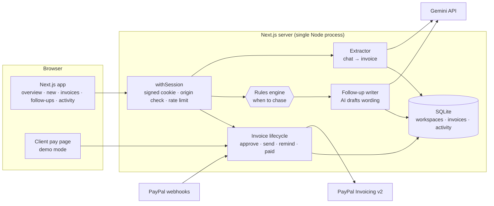
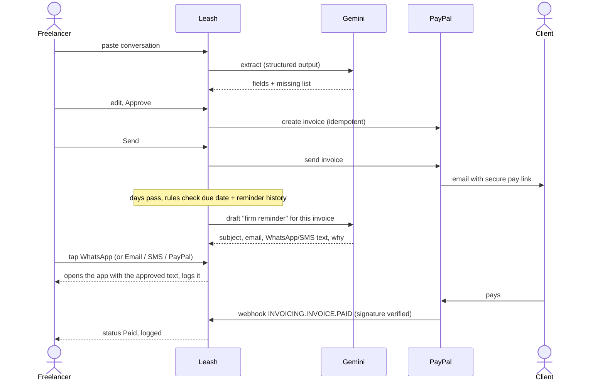

# Leash: system design

## Architecture



## The journey



## Rules engine (`lib/rules.ts`)

Pure function `assess(invoice, today)` → `{ action, label, reason, severity }`.

- `DRAFT` → **Approve**; `APPROVED` → **Send**; `PAID` / `CANCELLED` → nothing.
- `SENT`: days overdue 0 or less → **Wait**; 1–7 **Friendly**; 8–21 **Firm**; 22–30 **Final**; 31+ **Escalate**.
- One reminder per stage and a 3-day cool-down; once escalated, suggestions stop.
- Unit-tested (`tests/rules.test.ts`). The AI never chooses the action.

## Data model (SQLite via `node:sqlite`, WAL)

```
workspaces (id, created_at, last_seen, profile JSON)          -- one per browser, pruned after 30 idle days
invoices2  (id, workspace_id, created_at, status, paypal_invoice_id, data JSON)
            data: number, client{name,email,phone,company}, items, total, currency, due date,
                  note, source(chat|manual), paypal ids, pay link, reminders[{at,stage,channel}]
activity   (id, workspace_id, at, invoice_id, data JSON)      -- actor: you | ai | paypal | system
```

Indexes: invoices by workspace + date, by PayPal id (webhooks); activity by workspace + time.

## Assistant: transact with confirmation

The Gemini assistant (`lib/agent.ts`) uses function calling. Read tools (`get_summary`, `list_invoices`, `list_followups`, `check_inbox`) answer from the workspace; `create_invoice_draft` writes a DRAFT only. Two tools *prepare* money-moving or client-facing actions:

- `prepare_send_invoice` returns an action card with the steps (`approve` + `send`, or `send`).
- `draft_reminder` picks the stage with the rules engine, drafts the text, and returns an action card for `remind` via PayPal, email or Telegram (falls back to PayPal if that channel isn't connected).

The model has no tool that executes these. The card is rendered in the browser, the text is editable, and **Confirm & send** calls the same `/api/invoices/[id]` endpoint as the invoice page, so the same validation, idempotency and activity logging apply. In live mode the assistant also gets PayPal's **Agent Toolkit** read-only invoicing tools (`lib/paypalToolkit.ts`, prefixed `paypal_`), converted from the toolkit's OpenAI-format schemas to Gemini function declarations.

## Multi-currency and QR

Each invoice keeps its own currency end to end (PayPal bills in it). `/api/state` adds daily ECB rates (`lib/fx.ts`, Frankfurter, 6-hour cache, 4-second timeout, null when offline); the dashboard shows exact per-currency amounts and an approximate home-currency total. Pay-link QR codes are generated in the browser (`qrcode`), so links are never sent to a third-party QR service.

## One-tap sending

- **PayPal**: `POST /v2/invoicing/invoices/{id}/remind` with the approved subject and note.
- **Email / WhatsApp / SMS**: deep links (`mailto:`, `https://wa.me/…?text=`, `sms:…?&body=`) open the freelancer's own app with the approved text; no message goes out without them pressing send there too. The tap is logged.
- **Copy**: clipboard, logged.

## Security

| Risk | Control |
|---|---|
| AI acting on its own | AI only returns drafts. Approve / send / remind are explicit POSTs from user clicks; every one is logged. |
| Prompt injection in pasted chats | Conversation passed as data in a delimited block; output is a typed schema; the person reviews every field. |
| Hallucinated details | Extractor must leave unknown fields empty and list them as missing; the UI highlights them; approval needs an email. |
| Cross-site requests / session theft | Same-origin check on all writes; HMAC-signed, HttpOnly, SameSite=Lax cookie (Secure in production). |
| Abuse / cost | Per-workspace rate limits; input size caps; follow-up suggestions logged at most once per 12h per stage. |
| Duplicate invoices | `PayPal-Request-Id` idempotency key = invoice number. |
| Forged webhooks | Verified with PayPal `verify-webhook-signature` before any change. |
| Pay-link guessing (demo) | 96-bit random token, constant-time compare, never sent to the app UI. |
| XSS / clickjacking | Strict CSP, `frame-ancestors 'none'`, nosniff, referrer and permissions policies, HSTS in production. |

## Performance

Static pre-rendered pages; one `/api/state` call shared via React context; AG Grid lazy-loaded; inline SVG art; self-hosted font. Production build: zero console errors on every page.

## Scaling path

Postgres instead of SQLite (same tables) · Redis rate limits · a scheduled job (Render cron) that runs `assess` daily and emails the freelancer a digest of suggested follow-ups · real accounts with team roles.
